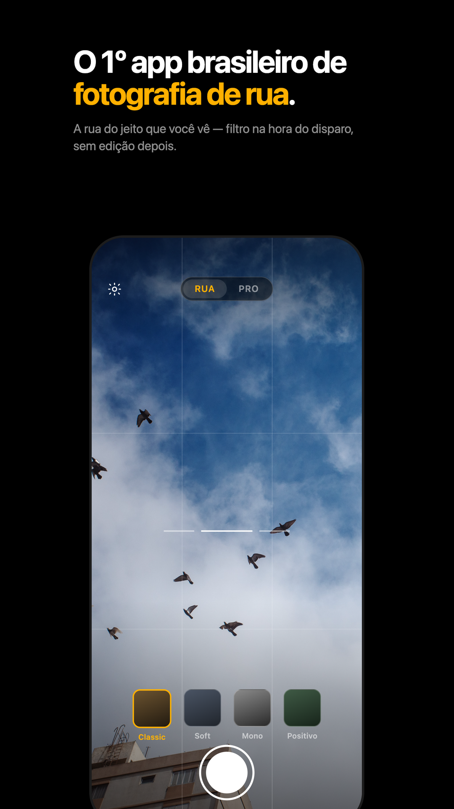
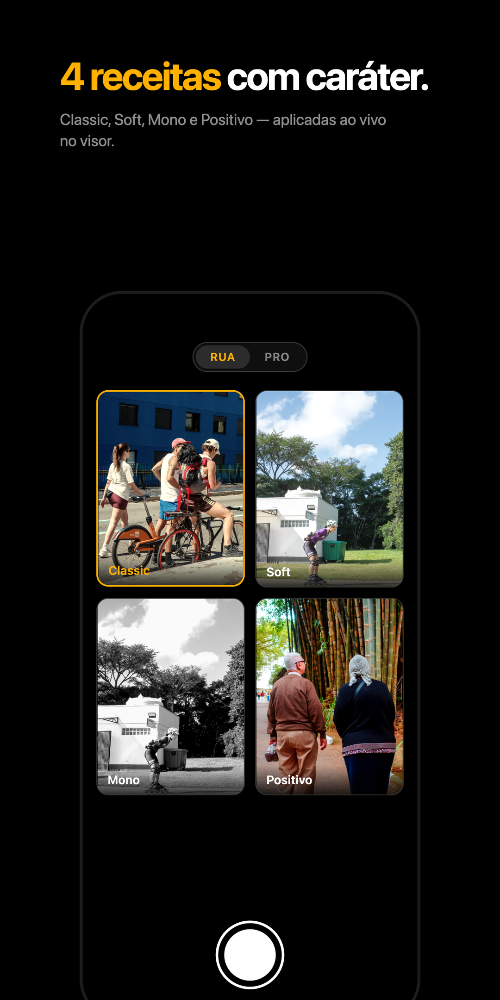
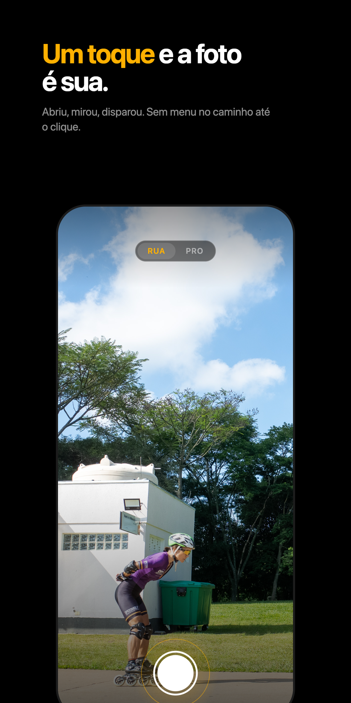
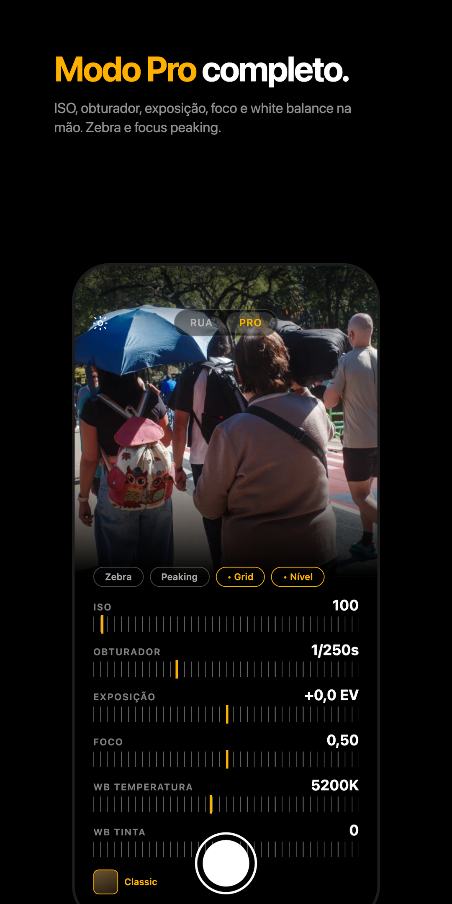

# I See Life (Android)

Câmera de fotografia de rua para Android, local-first e 100% offline, que aplica uma "receita" de cor na hora do disparo, com preview igual ao arquivo final (WYSIWYG).

Este é o port Android nativo do app iOS I See Life. As duas bases são independentes; a paridade é de comportamento, não de código. A versão iOS está na [App Store](https://apps.apple.com/br/app/i-see-life/id6799311673).

## Prints

<p>
  
  
  
  
</p>

## Principais funcionalidades

- Receitas de cor de catálogo fixo (Neutra, Classic, Soft, Retrato 400 e receitas inspiradas na Ricoh GR III), aplicadas ao vivo no visor e gravadas no JPEG.
- Mesmo shader no preview e na captura: o que se vê é o que se salva.
- Modo Rua: toque para travar foco/exposição e prioridade de obturador (1/250, 1/500, 1/1000).
- Modo Pro: ISO, obturador, exposição, foco e white balance manuais.
- Disparo pela tela, pelos botões de volume, por App Shortcut e por bloco nas Configurações Rápidas.
- Grade de terços, indicador de nível, preview P&B e captura silenciosa.
- Interface em português e inglês, com troca de idioma em tempo real.
- Compra única (sem assinatura) via Google Play Billing, com uma cota de fotos grátis antes do paywall.
- Sem conta, sem backend, sem analytics: as fotos não saem do aparelho.

## Stack técnica

- Kotlin + Jetpack Compose (Material 3)
- CameraX (com Camera2 Interop para controles manuais)
- OpenGL ES 2.0 / GLSL para os filtros (preview e captura)
- Room (SQLite local) e DataStore
- Google Play Billing
- Gradle (Kotlin DSL) com version catalog; `minSdk 26`, phone e retrato apenas

## Como foi construído

Desenvolvido com Claude (Anthropic) a partir de uma especificação SDD: [`spec.md`](spec.md), com o modelo de dados em [`modelo-i-see-life-android.dbml`](modelo-i-see-life-android.dbml). O trabalho foi feito por épicos definidos na spec, com verificação no emulador.

- Guia para o agente de código, com as regras que não podem ser quebradas: [`CLAUDE.md`](CLAUDE.md).
- Testes unitários (JUnit) em [`app/src/test`](app/src/test) — catálogo de receitas e conversão receita → uniforms do shader.
- Testes instrumentados em [`app/src/androidTest`](app/src/androidTest) — pipeline de shader e contact sheet das receitas.
- Documentação técnica (modelo de dados, regras, mapa de telas, divergências em relação ao iOS): [`DOCUMENTACAO-TECNICA.md`](DOCUMENTACAO-TECNICA.md).

## Status

Publicado na Google Play (distribuição no Brasil).

## Licença

O código está disponível apenas para leitura e estudo. Veja [LICENSE](LICENSE).

## Contribuições

Issues são bem-vindas; pull requests não são aceitos. Veja [CONTRIBUTING.md](CONTRIBUTING.md).

## Como rodar

Requer Android Studio (SDK + emulador) e JDK 17/21.

```bash
export JAVA_HOME=/caminho/para/jdk-21
./gradlew :app:assembleDebug     # gera app/build/outputs/apk/debug/app-debug.apk
./gradlew test                   # testes unitários
```

`local.properties` (não versionado) aponta o SDK:

```
sdk.dir=/caminho/para/android-sdk
```

Ou abra a pasta no Android Studio e rode no emulador ou aparelho. O comportamento da câmera (exposição e foco manuais, prioridade de obturador) só pode ser validado em aparelho real.

---

Feito pela [Dab Lab](https://www.dablab.com.br/) — agência de inovação no-code para startups e PMEs, com automações usando IA.
